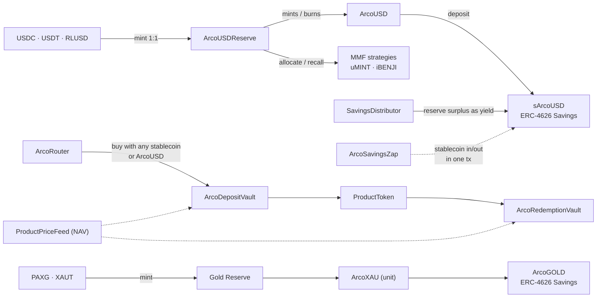

# Arco on GIWA

Arco is the RWA yield layer for GIWA. It connects crypto assets (e.g., BTC), gold and
dollar stablecoins on GIWA to institutional real-world yield:

- **ArcoUSD**: a 1:1 DeFi dollar. Deposit USDC, USDT or RLUSD and receive ArcoUSD; redeem 1:1.
- **Savings**: ERC-4626 vaults that pay yield in the deposited unit (sArcoUSD for dollars, ArcoGOLD for gold).
- **Funds**: vaults that wrap tokenized RWA funds (e.g., UBS uMINT, Figure HELOC via Nuva) as GIWA-native product tokens.

Everything below runs on **GIWA Sepolia (chain 91342)**.

| | |
|---|---|
| Live app | https://app.arco.financial |
| Product docs | https://docs.arco.financial |
| Explorer | https://sepolia-explorer.giwa.io |

**Repository scope.** [ArcoRWA/ARCO-GIWA](https://github.com/ArcoRWA/ARCO-GIWA) is a filtered snapshot of
Arco's working repository, published for review. It holds the contracts, their tests, the app and the API.
Internal operations tooling (runbooks, deployment and admin operations scripts, and testnet-only automation
jobs) is not included. The `Contracts` workflow compiles the contracts and runs their tests on every push.

## For reviewers: where to start

| What | Where |
|---|---|
| ArcoUSD, Reserve, Router, sArcoUSD, Zap, Distributor | `packages/contracts/contracts/arcousd/` |
| Funds vaults (deposit / redemption) | `packages/contracts/contracts/vaults/` |
| Product token and NAV price feed | `packages/contracts/contracts/ProductToken.sol`, `ProductPriceFeed.sol` |
| Access control and pausing | `packages/contracts/contracts/access/` |
| Contract tests | `packages/contracts/test/` |
| Deployed addresses (source of truth) | `deployments/91342/*.json` |
| Architecture with diagrams per feature | `docs/ARCHITECTURE.md` |

Compiler: Solidity 0.8.28, optimizer 200 runs, `evmVersion: cancun`. OpenZeppelin 4.9.6
(upgradeable contracts behind transparent proxies).

## Architecture



- **ArcoUSDReserve** holds stablecoin buffers per asset, mints/burns ArcoUSD 1:1, queues
  redemptions when a buffer is short, and allocates part of the reserve to MMF strategies.
- **sArcoUSD** accrues yield every second from surplus that `ArcoUSDSavingsDistributor`
  mints in (capped APR, vesting window). A seed position keeps a share-price floor.
- **Funds** use a deposit vault / redemption vault pair per product; the vaults settle
  against the off-chain fund's subscription and redemption cycle, priced by `ProductPriceFeed`.
- **ArcoGOLD** reuses the ArcoUSD and sArcoUSD logic (`ArcoUSDNamed`, `SArcoUSDNamed`)
  with an ounce-denominated unit, ArcoXAU.

Per-feature flows, functions to review, invariants and roles: **[docs/ARCHITECTURE.md](docs/ARCHITECTURE.md)**.

## Deployed contracts (GIWA Sepolia)

Proxies are listed; implementations, deploy transactions and role grants are in
`deployments/91342/*.json`. All contracts below are source-verified on the explorer
(proxies resolve to their verified implementations).

| Contract | Address | Source |
|---|---|---|
| ArcoUSD | `0x3d6Cb251d6aA62591ce9f6a13781a6dC590411Da` | `arcousd/ArcoUSD.sol` |
| ArcoUSDReserve | `0x4942711396B53df5b02fD8065E77FA2c9D27512F` | `arcousd/ArcoUSDReserve.sol` |
| ArcoRouter | `0x593C781c116CA5f65341Bda3557BC79Ce73D703f` | `arcousd/ArcoRouter.sol` |
| sArcoUSD | `0xcAEF04FeA7f9c2561dbCA95E39a6b06043df30Fd` | `arcousd/SArcoUSD.sol` |
| ArcoSavingsZap | `0xf4554ea97218645cF2EB209Cd540BD91321ba1E1` | `arcousd/ArcoSavingsZap.sol` |
| ArcoUSDSavingsDistributor | `0xdEF6c1338A6219a8A6e2B926cdb7a92B3229df18` | `arcousd/ArcoUSDSavingsDistributor.sol` |
| ArcoUSDReserveLens | `0x70cb2944C2dA5f199082A797f045CA2fded08866` | `arcousd/ArcoUSDReserveLens.sol` |
| ArcoXAU (gold unit) | `0x19fe2B0a9E014C85db70bFaEb3E01d2678d7DF29` | `arcousd/ArcoUSDNamed.sol` |
| Gold Reserve | `0x6A318D07F08ae3fb64956Bd29fbF7e2be7BB84BA` | `arcousd/ArcoUSDReserve.sol` |
| ArcoGOLD | `0xCfBB1da2040Bd559B2d7a96F818494d922Fb1860` | `arcousd/SArcoUSDNamed.sol` |
| uMINT product token | `0x24c67A5C506FbD9abc2793Bb0967004E88061f8b` | `ProductToken.sol` |
| uMINT deposit vault | `0xf3c43cD61993f4DCc4203547acB77fDE8F56ba8b` | `vaults/ArcoDepositVault.sol` |
| uMINT redemption vault | `0xc4075029B9E854A7Ef28D53749560564c607Ea67` | `vaults/ArcoRedemptionVault.sol` |
| HOME product token | `0xD45eDf9C5d761293CE1023Ca1b3f64D75eEfEc80` | `ProductToken.sol` |
| HOME deposit vault | `0x930F3775D8cA468aAD6b8Bb170443b0222AEdF87` | `vaults/ArcoDepositVault.sol` |
| HOME redemption vault | `0x58eb7DDF65CA3bAa7250e2018f7a66ed17D4C30C` | `vaults/ArcoRedemptionVault.sol` |
| Test asset faucet | `0x785918816f5f5ED6a8C5EDF5E223f14223bF41Bc` | `TestAssetFaucet.sol` |
| ProxyAdmin | `0x848aE1a652dB347F5a8a6C74ceF3006D64e7d64e` | OpenZeppelin |

Deployed after the list above (check each on the explorer for its verification status):

| Contract | Address | Source |
|---|---|---|
| ArcoGOLD distributor | `0x250485367b0Fe3a89c43E0336294358dBa5f8C7B` | `arcousd/ArcoUSDSavingsDistributor.sol` |
| ArcoGOLD Zap | `0x6C67403808DCDA693e5B9f2ddF543659FF3f27B4` | `arcousd/ArcoSavingsZap.sol` |
| Gold Reserve Lens | `0x00566CFb2A016Af64909125010020F67fdc616A5` | `arcousd/ArcoUSDReserveLens.sol` |
| JX product token | `0xec32264813612AdFf58538a7b8ddd2FE7E78639b` | `ProductToken.sol` |
| JX deposit vault | `0x35F0b76bE975934b52156c7a42B7285b34f416F9` | `vaults/ArcoDepositVault.sol` |
| JX redemption vault | `0x3Cb9EB0Dd0e22736815E5769710a6B11C79d4337` | `vaults/ArcoRedemptionVault.sol` |
| PPLUS product token | `0x28570accaDB959584478b9Ec35343befc5490c42` | `ProductToken.sol` |
| PPLUS deposit vault | `0x14c2aF588F0435CF18b4F0dAA722A2c54A1dAdF8` | `vaults/ArcoDepositVault.sol` |
| PPLUS redemption vault | `0xC0Cf3bc5BeDe3a827eC4Ffc588B34399E9934248` | `vaults/ArcoRedemptionVault.sol` |

Stablecoins and gold on testnet are test tokens (tUSDC, tUSDT, tRLUSD, tPAXG, tXAUT) from the faucet.

## Try it on testnet

1. Open https://app.arco.financial and connect a wallet on GIWA Sepolia.
2. Claim test assets from the faucet in the app.
3. Mint ArcoUSD with tUSDC, then deposit into Savings (sArcoUSD).
4. Buy a Funds product (e.g., uMINT) with a stablecoin through the Router.
5. Redeem: Savings instantly within the liquidity buffer, Funds on the product's cycle.

**Prices on testnet.** Testnet fund prices are simulated by an internal operator job; they are not market data.
On mainnet, each product's price feed will be updated from the asset manager's published NAV. The on-chain guard
stays `ProductPriceFeed`: `setRoundDataSafe` caps how far one update can move the price (`maxDeviationBps`), and
reads revert once the price is older than `healthyDiff`.

## Admin, roles and security

- **Testnet:** a single admin EOA (`0xFDCf58E2954988E5bf0446aAF1284A1069136F29`) holds the
  admin, operator and pauser roles for speed of iteration.
- **Mainnet plan:** admin roles move to MPC custody (Fireblocks or Fordefi) with 3-of-5
  approval, separated from the day-to-day operator role.
- Mint/burn of ArcoUSD is restricted to the Reserve (and the Savings distributor for yield).
  Contracts support per-function pausing and an address blacklist.
- **Audits:** not yet audited. Two external audits are planned before mainnet.
- Please report security issues privately to mike@arco.financial.

## Run and test locally

Requires Node.js 22 and corepack (`corepack enable`). No secrets or RPC access are needed for the tests.

```sh
npm install
npm run evm:build          # compile the contracts (Hardhat, yarn 4 via corepack)
npm run evm:test           # contract tests: core suite, then the Stocks suite on its isolated config
npm run prisma:generate    # Prisma client for the server (no database needed)
npm test                   # security checks, server and frontend tests (in-memory fakes, no database)
npm run dev                # app on http://localhost:5173
```

The contract tests are also split: `cd packages/contracts && corepack yarn test:core` or `corepack yarn test:stocks`.
The `Contracts` GitHub workflow runs the same two suites on every push.

Environment variables are documented in `.env.example`. Setup notes: `docs/DEVELOPMENT.md`.
Contracts on GIWA Sepolia are live; do not redeploy them.

## License

Contracts: GPL-3.0-only unless a file header says otherwise
(see `packages/contracts/LICENSE-INVENTORY.md`).
