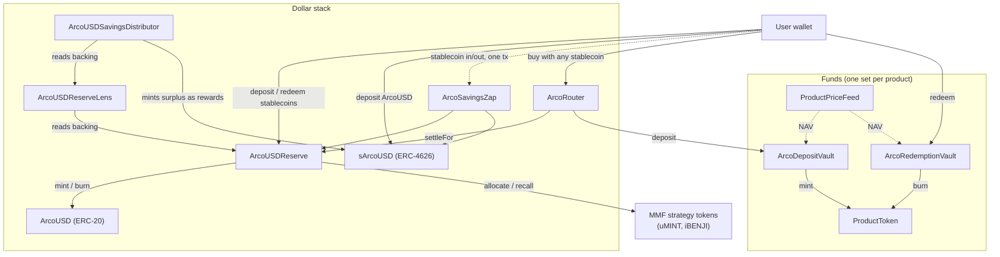
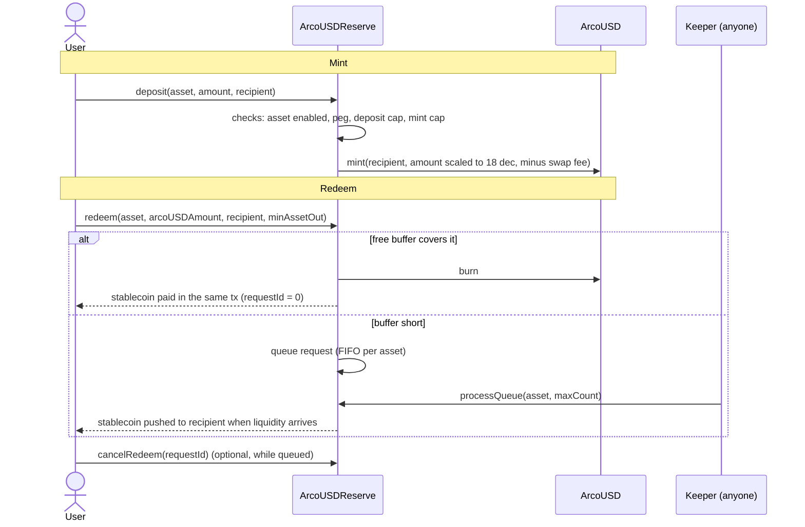
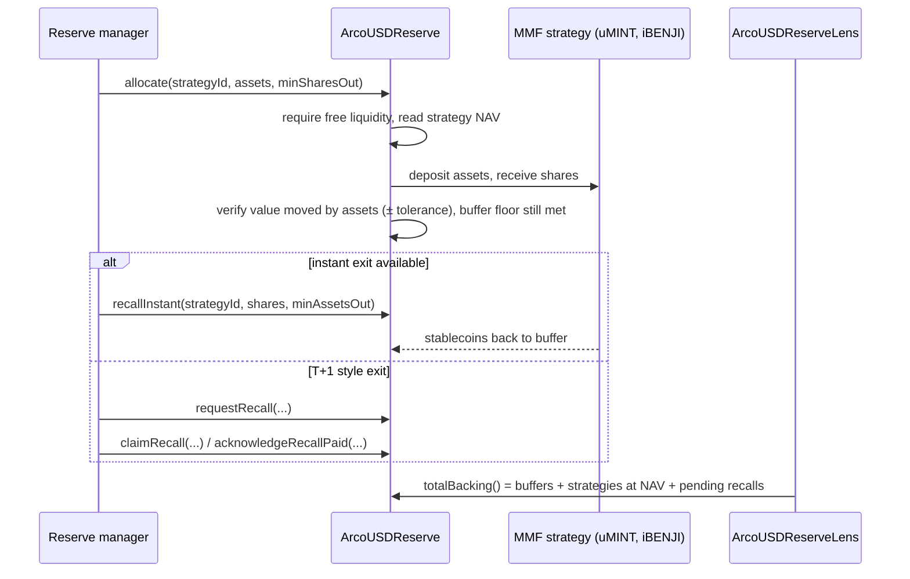
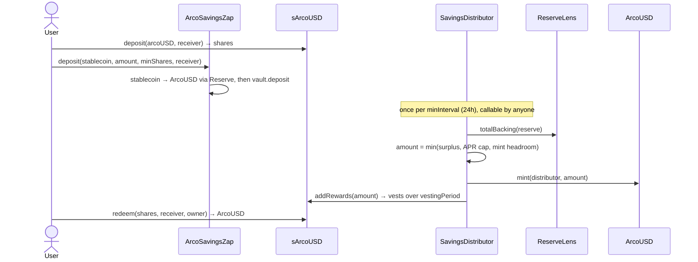
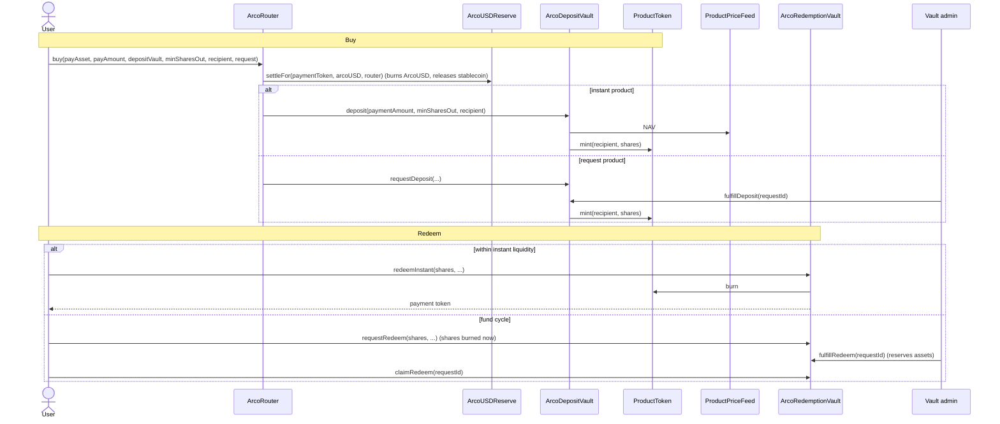
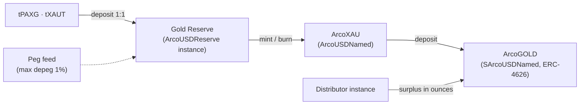
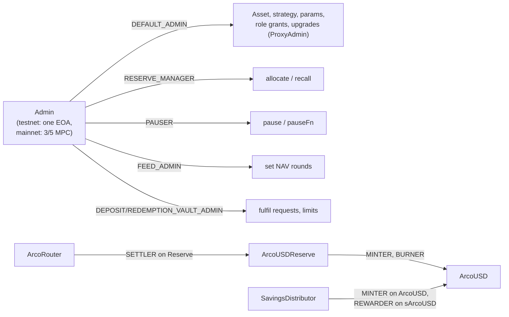
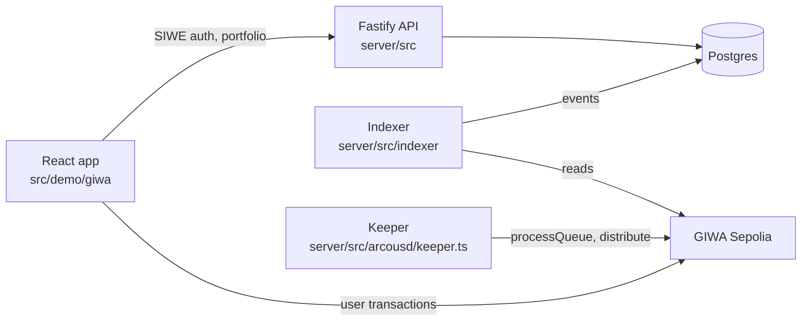

# Architecture

One page per feature: what it does, the call flow, the contracts and functions to read, and
who can do what. Paths are relative to `packages/contracts/contracts/`. Every diagram matches
the contracts deployed on GIWA Sepolia (chain 91342); addresses are in the
[README](../README.md#deployed-contracts-giwa-sepolia).

- [1. System overview](#1-system-overview)
- [2. ArcoUSD: mint and redeem](#2-arcousd-mint-and-redeem)
- [3. Reserve management: buffers and MMF strategies](#3-reserve-management-buffers-and-mmf-strategies)
- [4. Savings: sArcoUSD and yield distribution](#4-savings-sarcousd-and-yield-distribution)
- [5. Funds: buy and redeem a product](#5-funds-buy-and-redeem-a-product)
- [6. ArcoGOLD: gold savings](#6-arcogold-gold-savings)
- [7. Roles and permissions](#7-roles-and-permissions)
- [8. Off-chain components](#8-off-chain-components)

---

## 1. System overview

| Contract | File | Upgradeable |
|---|---|---|
| ArcoUSD | `arcousd/ArcoUSD.sol` | Yes (transparent proxy) |
| ArcoUSDReserve | `arcousd/ArcoUSDReserve.sol` | Yes |
| sArcoUSD | `arcousd/SArcoUSD.sol` | Yes |
| ArcoRouter | `arcousd/ArcoRouter.sol` | Yes |
| ArcoSavingsZap | `arcousd/ArcoSavingsZap.sol` | No |
| ArcoUSDSavingsDistributor | `arcousd/ArcoUSDSavingsDistributor.sol` | No |
| ArcoUSDReserveLens | `arcousd/ArcoUSDReserveLens.sol` | No (stateless reads) |
| ArcoDepositVault / ArcoRedemptionVault | `vaults/` | Yes |
| ProductToken | `ProductToken.sol` | Yes |
| ProductPriceFeed | `ProductPriceFeed.sol` | Yes |

---

## 2. ArcoUSD: mint and redeem

ArcoUSD is minted 1:1 against supported stablecoins and only the Reserve can mint or burn
it for users. Redemptions are paid instantly from the stablecoin buffer when it covers the
amount; otherwise they wait in a per-asset FIFO queue.

**Read:** `ArcoUSDReserve.deposit`, `redeem`, `redeemWithPermit`, `redeemInstantOnly`,
`processQueue`, `cancelRedeem`; `ArcoUSD.mint`, `burn`.

**Invariants to check**
- ArcoUSD supply never exceeds `mintCap`.
- Mint uses the amount actually received (fee-on-transfer safe) and checks the asset's peg feed.
- `processQueue` keeps every request's place when it stops (head too young, buffer short,
  low gas, token-wide transfer failure); only a recipient-specific failure marks a request `PayoutFailed`.
- Swap fees apply to non-base stablecoins only (testnet: tUSDC 0 bps, tUSDT/tRLUSD 10 bps).

---

## 3. Reserve management: buffers and MMF strategies

Part of the reserve is allocated to tokenized money market funds. Allocation never drains
the buffer below its floor, and strategy value is checked before and after each move.

**Read:** `allocate`, `recallInstant`, `requestRecall`, `claimRecall`,
`acknowledgeRecallPaid`, `strategyValue`, `availableLiquidity`; `ArcoUSDReserveLens.totalBacking`.

**Testnet parameters:** MMF target 50% (`mmfTargetBps 5000`), buffer floor 30%
(`bufferFloorBps 3000`), queue minimum delay 600 s.

---

## 4. Savings: sArcoUSD and yield distribution

sArcoUSD is a standard ERC-4626 vault over ArcoUSD. Yield is the Reserve's surplus
(backing above ArcoUSD supply, minus a safety margin), minted as ArcoUSD into the vault and
vested into the share price over 24 hours.

**Read:** `SArcoUSD.addRewards`, `totalAssets`, `unvestedAmount`, `seed`,
`maxRedeem`; `ArcoUSDSavingsDistributor.distribute`, `preview`; `ArcoSavingsZap.deposit`, `redeem`.

**Invariants to check**
- `totalAssets` excludes unvested rewards (no instant jump to front-run).
- Rewards revert with no depositors; a seed position (`seed()`) keeps a share-price floor.
- Distribution is capped by `maxAprBps` (testnet 20%) and leaves `reserveMarginBps` (0.5%) of backing.
- Pause and blacklist are enforced in `max*` views and in deposit/withdraw.

---

## 5. Funds: buy and redeem a product

Each product (e.g., uMINT, HOME) has a ProductToken, a deposit vault, a redemption vault and
a NAV price feed. Users can pay with any Reserve stablecoin or ArcoUSD through the Router,
which settles to the vault's payment token through the Reserve. Products that settle on an
off-chain fund cycle use request and fulfil.

**Read:** `ArcoRouter.buy`, `quoteBuy`; `ArcoUSDReserve.settleFor`;
`ArcoDepositVault.deposit`, `requestDeposit`, `fulfillDeposit`, `withdrawTo`;
`ArcoRedemptionVault.redeemInstant`, `requestRedeem`, `fulfillRedeem`, `claimRedeem`;
`ProductPriceFeed.setRoundDataSafe`.

**Invariants to check**
- The Router only buys into vaults allowed by `setVault`, and holds no funds between calls.
- `settleFor` pays only from the free buffer; when it is short the buy reverts.
- Request deposits check the recipient against the product's greenlist before taking funds.
- The price feed rejects stale rounds and moves larger than `maxDeviationBps`.

---

## 6. ArcoGOLD: gold savings

ArcoGOLD reuses the dollar stack's code under new names: `ArcoUSDNamed` becomes ArcoXAU, an
internal one-ounce unit backed 1:1 by tokenized gold (PAXG, XAUT), and `SArcoUSDNamed`
becomes the ArcoGOLD ERC-4626 vault. Its own Reserve, Lens, Distributor and Zap instances
mirror sections 2 to 4.

Testnet parameters: no MMF allocation (`mmfTargetBps 0`, buffer floor 100%), APR cap 3.1%.

---

## 7. Roles and permissions

| Role | Held by | Can do |
|---|---|---|
| `MINTER_ROLE`, `BURNER_ROLE` (ArcoUSD) | Reserve; Distributor (mint only) | Mint and burn ArcoUSD |
| `SETTLER_ROLE` (Reserve) | ArcoRouter | `settleFor` for product purchases |
| `REWARDER_ROLE` (sArcoUSD) | Distributor | `addRewards` |
| `RESERVE_MANAGER_ROLE` | Operator | Move reserve into and out of MMF strategies |
| `DEPOSIT_VAULT_ADMIN_ROLE`, `REDEMPTION_VAULT_ADMIN_ROLE` | Operator | Fulfil requests, set limits, withdraw vault proceeds |
| `FEED_ADMIN_ROLE` | Operator | Publish NAV |
| `PAUSER_ROLE` | Operator | Pause all or single functions |
| `BLACKLIST_OPERATOR_ROLE` | Operator | Blacklist addresses |
| `DEFAULT_ADMIN_ROLE` | Admin | Configuration and role grants |

On-chain role grants and their transactions are listed in `deployments/91342/*.json` (`roleGrants`).

---

## 8. Off-chain components

- The keeper wallet holds no admin role. It calls only the permissionless `processQueue` and
  `distribute`, each after a successful `eth_call` dry run, and its signer refuses any other call.
- Testnet-only operations jobs that need a role (and are not part of the public snapshot) run with
  their own wallet, never the keeper's.
- The indexer reads the registry once at startup and indexes the events listed in
  `deployments/91342/arco-giwa-preprod.json` (`events`).
